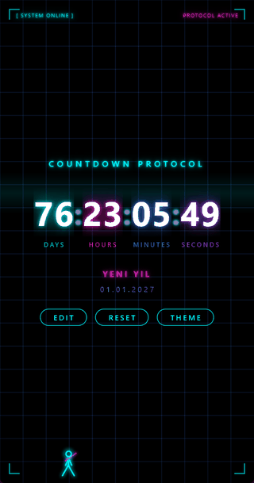
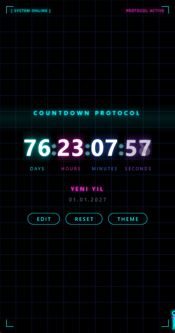
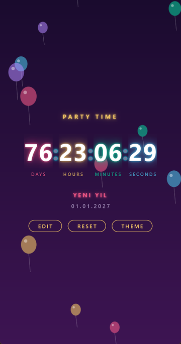
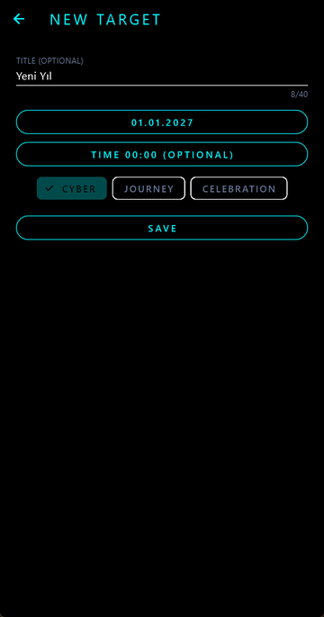
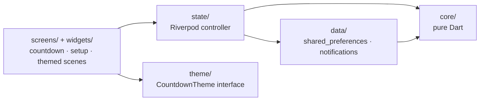

# Cyber Countdown

A Flutter countdown app with three animated themes. Set a target date, pick a look, and get reminders as the day approaches.

**[Try it in your browser](https://berkste.github.io/cyber-countdown/)** · **[Download the Android APK](https://github.com/Berkste/cyber-countdown/releases/latest)**

<p align="center">
  
</p>

| Cyber | Journey | Celebration | Setup |
|---|---|---|---|
|  |  |  |  |

> This is the showcase repository: screenshots, the live demo, the APK and the pure Dart core with its tests. The full app source is kept private. The web demo shows the countdown and themes; reminders need the Android app.

## Features

- **Countdown:** days, hours, minutes and seconds to a target date and optional time, with an optional title (up to 40 characters).
- **Three themes**, each with its own animated scene, colors and heading:
  - **Cyber:** neon grid, HUD frame, a boot sequence on launch and a marching figure.
  - **Journey:** a dusk sky, a plane crossing it and a road running to the horizon.
  - **Celebration:** drifting balloons, and a confetti burst when the target is reached.
- **Switch themes instantly** from the countdown screen; the choice applies to every screen, dialog and sheet.
- **Edit and reset:** change the target at any time; reset asks for confirmation. Past dates are rejected.
- **Reminders (Android):** notifications 7 days, 1 day and 1 hour before the target, and at the target itself. Notification permission is asked when you save a target, not at launch, and reminders are restored after the phone restarts.
- **Offline:** the countdown is stored on the device.

## Architecture



```
lib/
├── core/      pure Dart: Countdown, RemainingTime, form validation, ReminderPlanner, repository and scheduler interfaces
├── data/      shared_preferences repository, flutter_local_notifications scheduler
├── state/     Riverpod providers and the countdown controller
├── theme/     CountdownTheme interface and the Cyber, Journey and Celebration themes
├── screens/   countdown and setup screens
└── widgets/   animated scenes, countdown display, HUD frame
```

- **`core/` has no Flutter imports.** The countdown model, remaining-time math, form validation and the reminder schedule are plain Dart and tested without widgets.
- **Themes are an interface.** Each theme provides its colors, heading and background scene; screens never switch on the theme id.
- **Reminders are planned in Dart and scheduled by the platform.** `ReminderPlanner` decides which moments are still ahead; the notification scheduler only turns them into system notifications, so the schedule is tested without a device.
- **Desktop and web are visual demos.** They use a no-op scheduler; reminders are a mobile feature.

## Tests

The full app has 71 tests, all passing; `flutter analyze` reports no issues. The 26 core tests are included in this repository under [`core/test/core`](core/test/core).

| Layer | File | Tests |
|---|---|---|
| Core | `countdown_test.dart` | 9 |
| | `remaining_time_test.dart` | 8 |
| | `reminder_planner_test.dart` | 5 |
| | `countdown_form_test.dart` | 4 |
| Data | `shared_preferences_countdown_repository_test.dart` | 7 |
| State | `countdown_controller_test.dart` | 8 |
| Theme | `countdown_theme_test.dart` | 4 |
| Screens | `setup_screen_test.dart` | 21 |
| | `countdown_screen_test.dart` | 5 |

## The core package

[`core/`](core/) is the app's `core/` layer as a standalone Dart package with no Flutter dependency: the `Countdown` model, `RemainingTime`, form validation, `ReminderPlanner`, and the repository and scheduler interfaces.

```sh
cd core
dart pub get
dart test
```

## Known limitations

- **One countdown at a time.** There is no list of targets.
- **Reminders are Android only.** iOS is not set up yet; on the web and desktop the app shows the countdown without notifications.
- **Reminders are inexact.** They use Android's inexact scheduling, so one can arrive a minute or two late; this avoids the exact-alarm permission.
- **English UI only.**

## Tech stack

Flutter 3.47 · Dart 3.13 · Riverpod 3 · `shared_preferences` · `flutter_local_notifications` · fully offline, no backend.

## License

[MIT](LICENSE).
